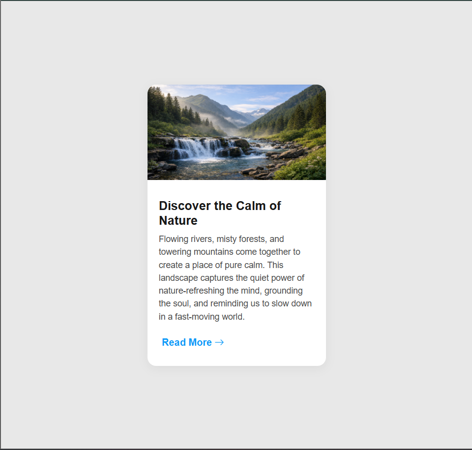

# Blog Post Card

A clean and responsive blog post card built using HTML and CSS. The project showcases a modern card layout featuring an image, article title, short description, and a "Read More" call-to-action.

---

## ✨ Features

- Responsive blog card layout
- Hover animation with elevation effect
- Smooth box-shadow transition
- Responsive design for mobile devices
- Modern typography using Google Fonts
- Bootstrap Icons integration
- Image loading skeleton animation using CSS keyframes

---

## 🛠 Technologies Used

- HTML5
- CSS3
- Google Fonts
- Bootstrap Icons

---

## 📚 What I Learned

During this project, I learned:

- How to build a reusable card component.
- How to use Flexbox for layout alignment.
- How to create smooth hover animations using `transform` and `box-shadow`.
- How to make a component responsive using media queries.
- How to use CSS keyframe animations to create an image loading placeholder effect.
- How to organize project assets using folders.
- How to deploy projects using GitHub Pages.

---

## 🚀 Live Demo

👉 https://shadowmask86.github.io/Blog-Post-Card/

---

## 📸 Screenshot



---

## 🚀 Future Improvements

- Add multiple blog cards with a responsive grid layout.
- Display author information and publication date.
- Add category tags.
- Include dark mode support.
- Connect the card to dynamic blog data using JavaScript.

---

## 💻 How to Run Locally

1. Clone the repository

```bash
git clone https://github.com/ShadowMask86/Blog-Post-Card.git
```

2. Open `index.html` in your browser.

---

## 👨‍💻 Author

**Shreyash**


